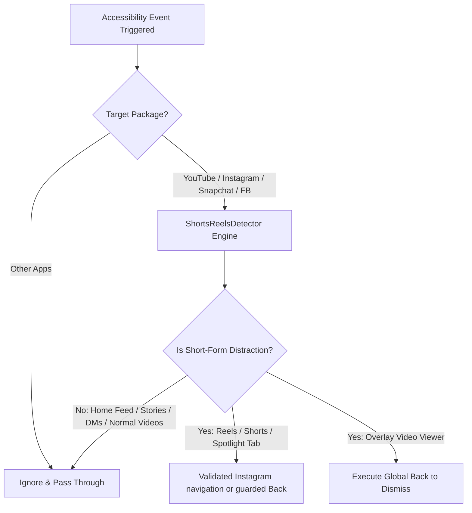

# FocusBlock 🛡️

> Android companion app for blocking short-form video screens. This checkout contains local Accessibility safety changes; device validation is pending.

FocusBlock is a lightweight, privacy-first Android application designed to help you reclaim your time and attention by instantly intercepting and blocking addictive short-form video loops (**YouTube Shorts**, **Instagram Reels**, **Snapchat Spotlight**, and **Facebook Reels**) without breaking standard app functionality.

---

## Privacy and Accessibility

The app's source declares no internet permission and contains no analytics integration. Its Accessibility service is configured for Instagram, YouTube, YouTube ReVanced, Snapchat, Facebook, and Facebook Lite. It inspects accessible screen structure and can perform clicks or Back navigation. Package event filtering reduces scope but is not a security sandbox for Accessibility capabilities.

This local checkout validates the active application/window, avoids cached activity/event state, rejects hidden nodes, and replaces generic text clicks with exact navigation IDs. Other apps use guarded Back until their safe navigation IDs are verified. Instagram Feed and Explore remain available.

See [BUILD-NOTES.md](BUILD-NOTES.md) for the changes, unrun tests, and build prerequisites. Compiling the app does not by itself establish safety; the final APK and behavior on the phone still need checking.

---

## 🚀 How to Install & Use

### Step 1: Install the APK
1. Download or transfer the latest `FocusBlock.apk` (or `FocusBlock-debug.apk`) to your phone.
2. Tap the APK in your phone's **Files / Downloads** app to install.

### Step 2: Verify the APK
Install only the artifact built from the reviewed source. Verify its signing certificate and SHA-256 hash. Keep Play Protect enabled and investigate installation warnings rather than assuming they are harmless.

### Step 3: Enable Accessibility Service
1. Open **FocusBlock**.
2. Tap **"Enable Accessibility"** (or open Phone Settings ➔ Accessibility).
3. Find **FocusBlock Protection Service** and switch it **ON**.
4. *(For Android 13/14/15 users)*: If the setting says *"Restricted Setting"*:
   - Go to phone **Settings ➔ Apps ➔ FocusBlock**.
   - Tap the **3 vertical dots (⋮)** in the top right corner.
   - Select **"Allow restricted settings"** (verify with fingerprint/PIN).
   - Return to **Accessibility** and turn **FocusBlock Protection Service** ON.
5. In FocusBlock, keep the **Master Protection** toggle **ON**.

---

## ✨ Features & Platform Support

- **Instagram Reels**:
  - Blocks the dedicated Reels tab and fullscreen video popups.
  - **Intended to preserve (requires device testing)**: Normal **Home Feed**, **Stories**, **Direct Messages (DMs)**, and **Search/Profile**.
- **Snapchat Spotlight**:
  - Blocks the Spotlight tab and full-screen Spotlight loops.
  - **Intended to preserve (requires device testing)**: **Camera**, **Chats**, **Friends list**, **Stories**, and **Maps** work completely normally.
- **YouTube Shorts & ReVanced**:
  - Blocks YouTube Shorts feed and Shorts bottom tab.
  - **Intended to preserve (requires device testing)**: Normal long-form videos, search results, subscriptions, and playlists play without interruption.
- **Facebook Reels**:
  - Intercepts and blocks Facebook Reels viewer and dedicated short-video tabs.
- **Non-Destructive Safe Tab Redirection**:
  - Instagram uses exact safe navigation IDs when available; otherwise it performs guarded Back. Other apps use guarded Back. This can leave the host app if its navigation stack has no previous screen.
- **Ultra Battery Efficient**:
  - Event-driven detection with a 40ms debounce; battery impact has not been measured in this checkout.

---

## 🏗️ Architecture & How It Works



### Key Modules:
- [`ShortsReelsDetector.kt`](file:///c:/Users/shubh/Downloads/blocker/app/src/main/java/com/focusblock/app/detector/ShortsReelsDetector.kt): Multi-signal evaluation engine combining fast view ID lookups, selected tab detection, and BFS hierarchy traversal with visible, package-matched nodes and conservative exclusions for non-distracting features.
- [`FocusBlockAccessibilityService.kt`](file:///c:/Users/shubh/Downloads/blocker/app/src/main/java/com/focusblock/app/service/FocusBlockAccessibilityService.kt): Core accessibility event processor with debouncing, cooldown management, and non-destructive tab escape algorithms.
- [`PreferencesHelper.kt`](file:///c:/Users/shubh/Downloads/blocker/app/src/main/java/com/focusblock/app/data/PreferencesHelper.kt): Manages Master Protection ON/OFF state.
- [`MainActivity.kt`](file:///c:/Users/shubh/Downloads/blocker/app/src/main/java/com/focusblock/app/ui/MainActivity.kt): Clean Material 3 dashboard displaying real-time service status, quick settings link, and master toggle.

---

## 🛠️ Building From Source

### Requirements:
- Android SDK (API 35, min API 26 / Android 8.0+)
- JDK 17+
- Gradle 8.7 (wrapper), Android Gradle Plugin 8.6.1

### Build Debug APK:
```bash
./gradlew assembleDebug
```
Output: `app/build/outputs/apk/debug/FocusBlock-debug.apk`

### Build Release APK:
```bash
./gradlew assembleRelease
```
Output: `app/build/outputs/apk/release/FocusBlock.apk`

### Install via ADB:
```bash
adb install -r app/build/outputs/apk/release/FocusBlock.apk
```

---

## License
The upstream README claims MIT licensing, but no application LICENSE file was included at the reviewed commit. Clarify licensing with upstream before redistribution.
